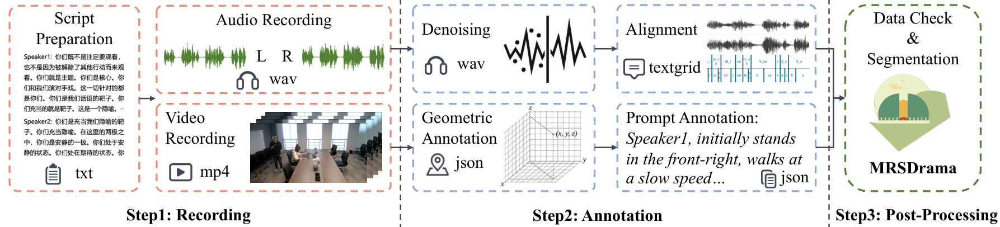
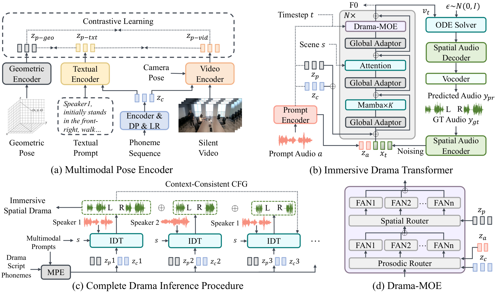

<h1>ISDrama: Immersive Spatial Drama Generation through Multimodal Prompting<br>
  <a href="https://acmmm2025.org/"></a>
</h1>

<p>
  <strong><a href="https://aaronz345.github.io/">Yu&nbsp;Zhang</a></strong>*, Wenxiang&nbsp;Guo*, Changhao&nbsp;Pan*, Zhiyuan&nbsp;Zhu*, Tao&nbsp;Jin, Zhou&nbsp;Zhao&ensp;
</p>

<p>
  <a href="https://arxiv.org/abs/2504.20630"></a>
  <a href="https://aaronz345.github.io/ISDramaDemo"></a>
  <a href="https://huggingface.co/datasets/AaronZ345/MRSDrama"></a>
  <a href="https://mp.weixin.qq.com/s/jrKT16zH115ZDYxa0b492w"></a>
  <a href="https://mp.weixin.qq.com/s/ZIC8rHDkwsKwcBwEi4v4DQ"></a>
  <a href="https://zhuanlan.zhihu.com/p/1930597017840779306"></a>
</p>

##  Overview

ISDrama introduces multimodal spatial drama generation and the MRSDrama recorded dataset. **This repository provides dataset access and spatial evaluation tools.** MRSDrama and MRSAudio are publicly released training resources for spatial audio generation and understanding.

For training, see the [datasets](#training-datasets) and [data format](docs/data-format.md). For paired audio metrics, see [Quick start](#quick-start) and the [evaluation guide](docs/evaluation.md). To cite this work, use the [BibTeX entry](#citations).

##  News

- **2025.07** · Released the evaluation code.
- **2025.07** · Released the full MRSDrama dataset.
- **2025.07** · ISDrama was accepted to ACM Multimedia 2025.

##  Quick start

| Resource | Available here |
| --- | --- |
| Training data | MRSDrama and MRSAudio download links |
| Evaluation | Paired spatial audio feature extraction and metrics |
| Encoder | Published BAT checkpoint, verified before loading |
| Runtime | Python 3.8 to 3.10; PyTorch 2.0.1; CPU or an existing CUDA device |

### 1. Install the environment

```bash
git clone https://github.com/AaronZ345/ISDrama.git
cd ISDrama
conda env create -f environment.yml
conda activate isdrama_eva
bash timm_patch/patch.sh
```

### 2. Prepare the encoder and paired audio

Download the published [BAT checkpoint](https://huggingface.co/datasets/zhisheng01/SpatialAudio/blob/main/SpatialAST/finetuned.pth) to `ckpt/finetuned.pth`. Its SHA-256 is checked before a private copy is loaded; custom or modified checkpoints are rejected.

Place ground-truth WAV files in `data/gt` and generated WAV files in `data/infer` with identical filenames. Each file must be stereo. Choose an output directory that does not exist.

### 3. Run spatial evaluation

```bash
bash evaluate/eval.sh --gt-dir data/gt --pred-dir data/infer \
  --checkpoint ckpt/finetuned.pth --output-dir outputs/run-1 --device cpu
```

The runner extracts BAT embeddings and IPD/ILD features, then reports mean absolute errors and distance/azimuth cosine similarities. It reserves the output directory and removes partial output if a stage fails. For CUDA, use `--device cuda` and select an existing GPU with `CUDA_VISIBLE_DEVICES`.

To evaluate IPD and ILD without the encoder checkpoint:

```bash
bash evaluate/eval.sh --gt-dir data/gt --pred-dir data/infer \
  --output-dir outputs/ipd-ild-run-1 --skip-embeddings
```

See the [evaluation guide](docs/evaluation.md) for metric definitions, numeric feature files, historical normalization, and evaluation of existing features.

##  Training datasets

| Dataset | Training resources | Access |
| --- | --- | --- |
| MRSDrama | Binaural drama, scripts, video, geometric poses, and text prompts | [Hugging Face](https://huggingface.co/datasets/AaronZ345/MRSDrama) · [Google Drive](https://drive.google.com/drive/folders/1ALpnOD4b_zgn8GSu4aS-cjdDK8vY6Lyy?usp=sharing) |
| MRSAudio | MRSLife, MRSSpeech, MRSSing, and MRSMusic with spatial recordings and multimodal annotations | [Hugging Face](https://huggingface.co/datasets/MRSAudio/MRSAudio) |

Prepare either dataset for your model's training pipeline and follow its own data card and license. The paired ground-truth/generated directories above are evaluation inputs. The encoder's BAT preprocessing profile does not select a training dataset.

Using MRSDrama means accepting its [dataset license](dataset_license.md). Its [data-format guide](docs/data-format.md) describes recordings, annotations, and listener-centric geometric sequences.

### MRSDrama data collection

<p align="center">
  
  <br>
  <sub><a href="https://arxiv.org/html/2504.20630v6#S2.F2">Figure 2</a>. How MRSDrama was recorded, annotated, and prepared.</sub>
</p>

##  Evaluation outputs

| Score | Definition |
| --- | --- |
| IPD MAE | Error between aligned interaural phase-difference features |
| ILD MAE | Error between aligned interaural level-difference features |
| Distance cosine similarity | Similarity between BAT distance embeddings |
| Azimuth cosine similarity | Similarity between BAT direction embeddings |

The default `--mae-normalization mean` averages the aligned time-frequency elements once and prints MAE multiplied by 100. Use `--mae-normalization legacy` only when reproducing the former extra frame-count division. Label the normalization in comparisons. All requested metric families must cover the same audio items; feature files use numeric arrays and are loaded without pickle.

##  Method and data

The paper introduces a Multimodal Pose Encoder and an Immersive Drama Transformer for binaural speech generation. The released MRSDrama data contains recorded drama, scripts, aligned annotations, video, poses, and prompts. See the [paper](https://arxiv.org/abs/2504.20630) for the generation architecture and model comparisons, and the [evaluation guide](docs/evaluation.md) for this repository's tools.

<p align="center">
  
  <br>
  <sub><a href="https://arxiv.org/html/2504.20630v6#S4.F4">Figure 4</a>. ISDrama generation architecture described in the paper.</sub>
</p>

##  Citations

If you find this code useful in your research, please cite our work:
```bib
@article{zhang2025isdrama,
  title={ISDrama: Immersive Spatial Drama Generation through Multimodal Prompting},
  author={Zhang, Yu and Guo, Wenxiang and Pan, Changhao and Zhu, Zhiyuan and Jin, Tao and Zhao, Zhou},
  journal={arXiv preprint arXiv:2504.20630},
  year={2025}
}
```

##  Disclaimer

Any organization or individual is prohibited from using any technology mentioned in this paper to generate someone's speech without his/her consent, including but not limited to government leaders, political figures, and celebrities. If you do not comply with this item, you could be in violation of copyright laws.
